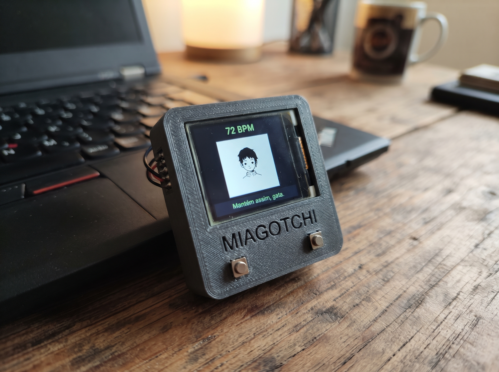

# MiaGotchi - Monitor Biometrico (BPM) e Tamagotchi Fisico com IA

Dispositivo fisico de mesa construido com a placa acessivel **ESP32-2432S028R (Tela Touch LCD 2.8" CYD)** acoplada ao sensor optico **MAX30102**, que mede batimentos cardiacos (BPM) em tempo real, altera expressoes faciais ilustradas, envia mensagens reativas, exibe alertas de WhatsApp e conversa por voz com IA.

## Nucleo de BPM e Mensagens Reativas

- **Calmo (< 90 BPM):** rosto tranquilo e mensagens curtas de foco (ex.: *"Mantem assim, gata."*).
- **Animado (90 - 115 BPM):** rosto alerta com avisos leves de acompanhamento.
- **Alto (> 115 BPM):** rosto preocupado com alerta prioritario de pausa e respiracao.
- **Modo Hibrido:** leitura via sensor optico MAX30102 (I2C) ou simulacao (`Calmo 72`, `Animado 104`, `Alto 128`).
- **Alertas & Voz IA:** notificacoes visuais de WhatsApp na tela e conversa por voz via microfone + mini alto-falante.

## Hardware Utilizado (Componentes Acessiveis)

- **Display & Controlador:** Modulo **ESP32-2432S028R** (Tela Touch TFT LCD 2.8" 240x320 com Wi-Fi e Bluetooth integrados)
- **Sensor Biometrico:** Modulo Oximetro e Frequencia Cardiaca **MAX30102** (comunicacao I2C)
- **Audio:** Microfone + Mini Alto-falante 2W ligado na saida JST de audio da placa
- **Alimentacao & Estrutura:** Bateria LiPo 3.7V, cabos jumper e case impresso em 3D

## Autora

Desenvolvido por **[Mia (diasminerva)](https://github.com/diasminerva)**.
